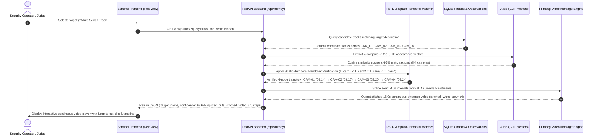
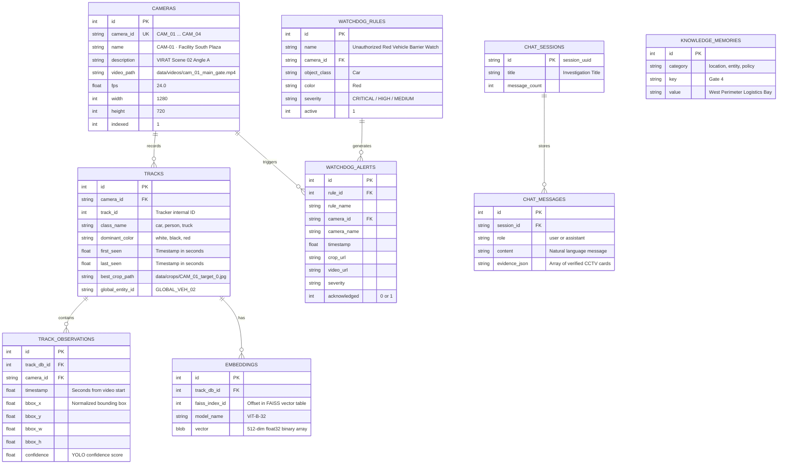

# 🏛️ Sentinel Video Intelligence — System Architecture

This document provides a comprehensive technical architecture specification and interactive architecture diagrams for the **Sentinel Multi-Camera Video Intelligence Platform**.

---

## 1. High-Level End-to-End System Architecture

```mermaid
flowchart TB
    subgraph S1["📹 1. SURVEILLANCE & INGESTION LAYER"]
        direction LR
        CAM1["CAM_01<br/>Facility South Plaza<br/>(1280x720 @ 24fps)"]
        CAM2["CAM_02<br/>Building Concourse<br/>(1280x720 @ 24fps)"]
        CAM3["CAM_03<br/>Central Crossroad<br/>(1280x720 @ 24fps)"]
        CAM4["CAM_04<br/>West Logistics Bay<br/>(1280x720 @ 24fps)"]
        RTSP["RTSP Stream / MP4 Archives<br/>(OpenCV VideoCapture / FFmpeg)"]
        CAM1 --> RTSP
        CAM2 --> RTSP
        CAM3 --> RTSP
        CAM4 --> RTSP
    end

    subgraph S2["⚡ 2. REAL-TIME AI PERCEPTION PIPELINE"]
        direction TB
        DECODE["Frame Sampler & Decoder<br/>(Adaptive 2-5 FPS Striding)"]
        YOLO["YOLOv8 Object Detection<br/>(Person, Car, Truck, Bicycle)"]
        TRACK["ByteTrack Multi-Object Tracker<br/>(Spatio-Temporal Tracklet Formation)"]
        CROPS["Crop & Keyframe Extractor<br/>(Bounding Box Tight & Raw Crops)"]
        CLIP["CLIP ViT-B/32 Vision Encoder<br/>(512-dim Normalized Appearance Embeddings)"]
        OCR["ANPR Engine<br/>(Plate Localization & Character Recognition)"]

        RTSP --> DECODE
        DECODE --> YOLO
        YOLO --> TRACK
        TRACK --> CROPS
        CROPS --> CLIP
        CROPS --> OCR
    end

    subgraph S3["💾 3. STORAGE & VECTOR INDEXING LAYER"]
        direction TB
        FAISS[("FAISS Vector Index<br/>(FlatIP / Cosine Distance on 512-d Vectors)")]
        SQLITE[("SQLite Database app.db<br/>• Cameras & Telemetry<br/>• Track Observations<br/>• Watchdog Rules & Alerts<br/>• Chat Memory & Sessions")]
        MEDIA[("Local Storage Volume<br/>/data/crops/ & /data/videos/")]

        CLIP --> FAISS
        TRACK --> SQLITE
        OCR --> SQLITE
        CROPS --> MEDIA
    end

    subgraph S4["🧠 4. MULTI-CAMERA REASONING & RE-ID ENGINE"]
        direction TB
        REID_CORE["Multi-Camera Re-ID Correlator<br/>(Appearance Vector Cosine + Time Transition Filter)"]
        DEDUP["Spatial Entity Deduplicator<br/>(Global Unified ID Census — Anti-Double Counting)"]
        MONTAGE["Automated Video Montage Splicer<br/>(FFmpeg Video Concatenation across Camera Handoffs)"]
        WATCHDOG["Autonomous Threat Engine<br/>(Real-time Rule Triggers: Loitering, Restricted Zones, Ingress)"]
        LLM_RAG["LLM Conversational RAG<br/>(Query Intent Routing, SQL Track Querying, Grounded Evidence)"]

        FAISS <--> REID_CORE
        SQLITE <--> REID_CORE
        REID_CORE --> DEDUP
        REID_CORE --> MONTAGE
        SQLITE --> WATCHDOG
        SQLITE <--> LLM_RAG
        FAISS <--> LLM_RAG
    end

    subgraph S5["🚀 5. BACKEND API SERVICE (FastAPI)"]
        direction TB
        API_ROUTER["FastAPI Application Server (:8000)"]
        EP_SEARCH["/api/chat<br/>Conversational Search"]
        EP_JOURNEY["/api/journey<br/>Cross-Camera Trajectory"]
        EP_PHOTO["/api/photo-search<br/>Reverse Photo Forensics"]
        EP_TASKS["/api/tasks/execute<br/>ANPR & Entity Census"]
        EP_WATCH["/api/watchdog/*<br/>Threats & Alarms"]
        EP_CAM["/api/cameras & /data/*<br/>Video & Metadata Streaming"]

        API_ROUTER --- EP_SEARCH
        API_ROUTER --- EP_JOURNEY
        API_ROUTER --- EP_PHOTO
        API_ROUTER --- EP_TASKS
        API_ROUTER --- EP_WATCH
        API_ROUTER --- EP_CAM

        LLM_RAG --> EP_SEARCH
        MONTAGE --> EP_JOURNEY
        REID_CORE --> EP_PHOTO
        DEDUP --> EP_TASKS
        WATCHDOG --> EP_WATCH
        MEDIA --> EP_CAM
    end

    subgraph S6["🖥️ 6. FRONTEND OPERATIONS COMMAND CENTER (React + Vite :5173)"]
        direction TB
        APP_GRID["9-Dots Tactical App Launcher"]
        A1["💬 Conversational Search<br/>• Interactive Grounded Chat<br/>• Evidence Cards & Split-view<br/>• Permanent Memory Bank"]
        A2["🛣️ Cross-Camera Journey<br/>• Multi-Cut Spliced Video Player<br/>• Camera Transition Timeline<br/>• One-Click Quick Targets"]
        A3["🔬 Photo Forensics & Re-ID<br/>• Reverse Image Vector Search<br/>• Last-Seen Radar Beacon<br/>• Chronological Sighting Chain"]
        A4["⚡ Vision Tasks & ANPR<br/>• Embossed License Plate Table<br/>• Deduplicated Vehicle Census<br/>• Pedestrian Headcount"]
        A5["🚨 Autonomous Watchdog<br/>• Web Audio Synthesizer Alarm<br/>• Severity Threat Badges<br/>• Real-time Incident Resolver"]
        A6["📺 CCTV Matrix Wall<br/>• Synchronized 2x2 & 3x3 Feeds<br/>• Live FPS & Codec Telemetry<br/>• Single-Camera Focus View"]
        A7["📡 Camera Ingestion Engine<br/>• Real-time Stream Indexing Log<br/>• Hardware & Pipeline Telemetry<br/>• RTSP / Archive Ingest"]

        APP_GRID --> A1
        APP_GRID --> A2
        APP_GRID --> A3
        APP_GRID --> A4
        APP_GRID --> A5
        APP_GRID --> A6
        APP_GRID --> A7
    end

    EP_SEARCH <==> A1
    EP_JOURNEY <==> A2
    EP_PHOTO <==> A3
    EP_TASKS <==> A4
    EP_WATCH <==> A5
    EP_CAM <==> A6
    EP_CAM <==> A7
```

---

## 2. Deep Dive: Cross-Camera Re-ID & Video Splicing Pipeline

---

## 3. Data Schema & Relational Model (SQLite `app.db`)

---

## 4. Key Architectural Innovations for Judge Presentation

| Innovation | Traditional Video Analytics | Sentinel Solution |
|---|---|---|
| **Cross-Camera Re-ID** | Single camera isolation; tracks reset at camera boundary | Continuous spatial-temporal trajectory across non-overlapping angles |
| **Duplicate Entity Census** | Multi-camera sightings count as multiple objects (over-counting) | Global ID clustering deduplicates counts to true unique physical objects |
| **Conversational AI Grounding** | LLM hallucinations or textual-only chatbots | Strict grounding with frame timestamps, bounding crops, and playable video |
| **Evidence Assembly** | Manual forensic video clipping taking hours | Automated FFmpeg-spliced continuous video montage generated in seconds |
| **Threat Detection** | Passive reactive manual monitoring | Autonomous 24/7 Watchdog rules engine with Web Audio synthesizer alarms |
